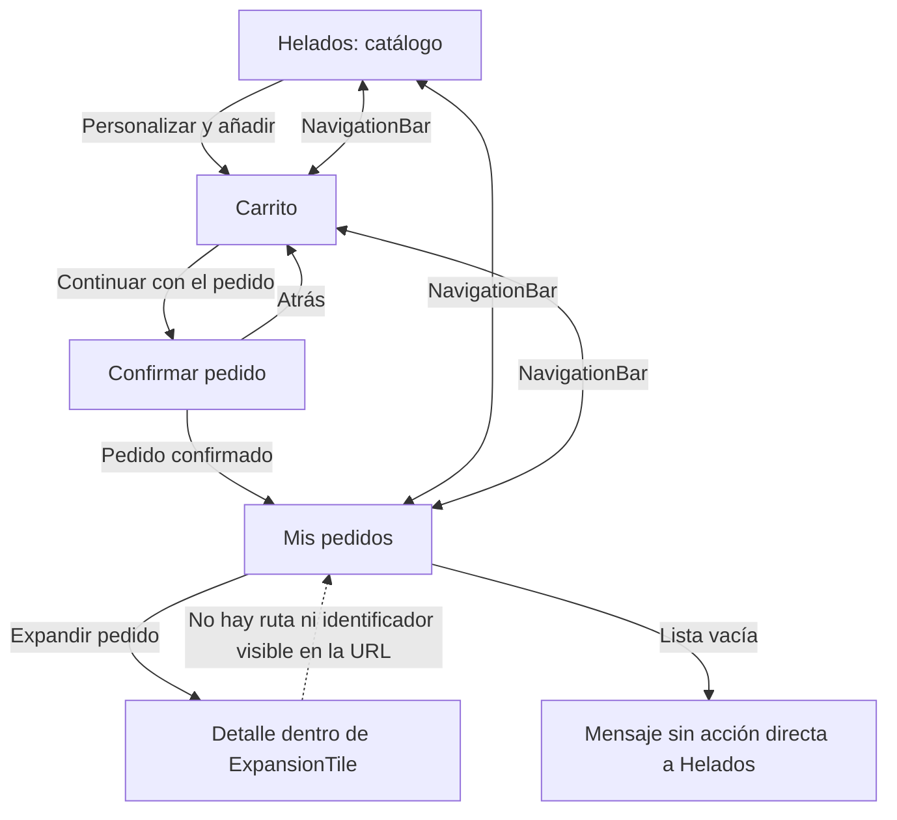

# CP1 - Auditoría UX de ICA

## Pantallas elegidas

- **Mis pedidos:** lista local persistida de pedidos, incluida la referencia, fecha, estado y artículos.
- **Confirmar pedido:** formulario que recoge el nombre para retirar el pedido y una nota opcional.

No se auditan catálogo ni personalización, que son el trabajo asignado a compañeros del equipo. La auditoría se basa en `app/frontend/lib/main.dart`, `store.dart` y `models.dart`.

Elementos propios de ICA revisados: la sección `Mis pedidos`, los campos del pedido `id`, `customer`, `status` e `items`, el formulario de recogida y el envío a `POST /api/orders` con `Idempotency-Key` en modo conectado. En modo demo, ese flujo crea pedidos simulados que se guardan localmente.

## Hallazgos

| Pantalla | Problema observado | Principio | Severidad | Arreglo propuesto |
| --- | --- | --- | --- | --- |
| Mis pedidos | Durante la lectura inicial de preferencias `orders` comienza vacío y la pantalla puede mostrar el mensaje de lista vacía antes de terminar la carga. | Estados de interfaz | Alta | Añadir estado de carga de pedidos separado del de catálogo y mostrar filas de esqueleto hasta completar la lectura. |
| Mis pedidos | Si falla la lectura de preferencias, el usuario ve un aviso general arriba, sin una acción para volver a cargar el historial. | Recuperación ante errores | Alta | Mostrar el error dentro de la lista y ofrecer un botón Reintentar que vuelva a leer los pedidos locales. |
| Mis pedidos | La vista vacía informa que no hay pedidos, pero la acción de explorar el catálogo no cambia directamente a la pestaña Helados. | Acción principal y prevención de callejones sin salida | Media | Convertir el mensaje en un botón que cambie a Helados. |
| Mis pedidos | Cada compra usa `ExpansionTile`; los detalles quedan ocultos hasta que se expande y no hay una pantalla dedicada. | Reconocimiento antes que recuerdo | Media | Abrir el detalle con referencia de pedido en una ruta/pantalla propia y conservar el botón de regreso. |
| Mis pedidos | No existe filtro ni búsqueda cuando el historial crece. | Eficiencia de uso | Baja | Añadir búsqueda por referencia/fecha si el volumen de pedidos lo justifica. |
| Confirmar pedido | El nombre tiene validación y el mensaje aparece al enviar, pero las reglas no se explican antes de que el usuario falle. | Prevención y recuperación de errores | Media | Añadir ayuda breve: mínimo 2 caracteres; mostrar el mensaje asociado al campo. |
| Confirmar pedido | El estado de error se presenta como texto dentro del formulario, pero no mueve el foco ni anuncia explícitamente el cambio a tecnologías de asistencia. | Retroalimentación accesible | Media | Enfocar el resumen de error y anunciarlo con una región semántica viva. |
| Confirmar pedido | Al enviar, el botón muestra un indicador y queda deshabilitado; el total permanece visible. | Visibilidad del estado del sistema | Baja | Mantener este patrón y asociar el indicador con una etiqueta “Enviando pedido”. |
| Confirmar pedido | El formulario está en una `ListView` con padding de 24 y se adapta en ancho, pero el título y el icono consumen espacio vertical en un teléfono pequeño con teclado abierto. | Diseño responsivo | Media | Reducir el encabezado en ancho/alto compacto y permitir que el campo activo siga visible al abrir el teclado. |
| Navegación | Las tres secciones principales usan `NavigationBar`; confirmar el pedido se abre en una ruta temporal desde el carrito. | Consistencia y control del usuario | Baja | Mantener pestañas para secciones principales y pila para formularios/detalles; hacer que el detalle de pedido use esa misma pila. |

## Mapa de navegación actual

El punto más débil es el detalle de compra: aparece dentro de una fila expandible y no tiene una ruta independiente. En la lista vacía, el usuario debe usar la barra inferior para volver al catálogo.

## Capturas antes

Pendientes de guardar desde una ejecución real de la app en `docs/img/`:

- `before-my-orders.png` - pestaña Mis pedidos en estado vacío o con un pedido.
- `before-checkout.png` - formulario Confirmar pedido con el carrito preparado.

No se agregan imágenes simuladas como si fueran capturas de la app.
